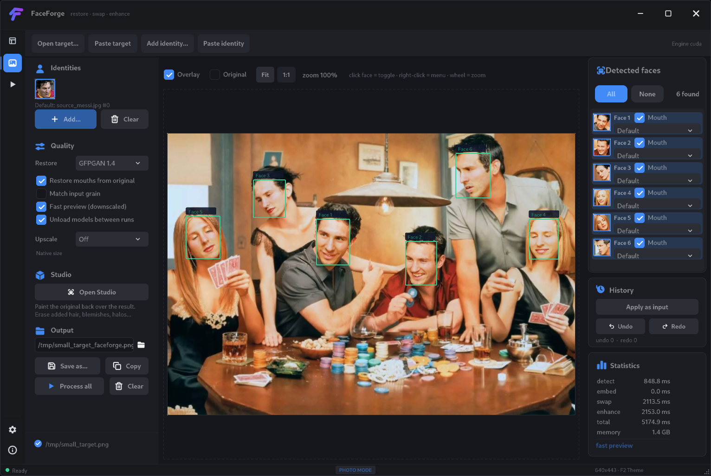
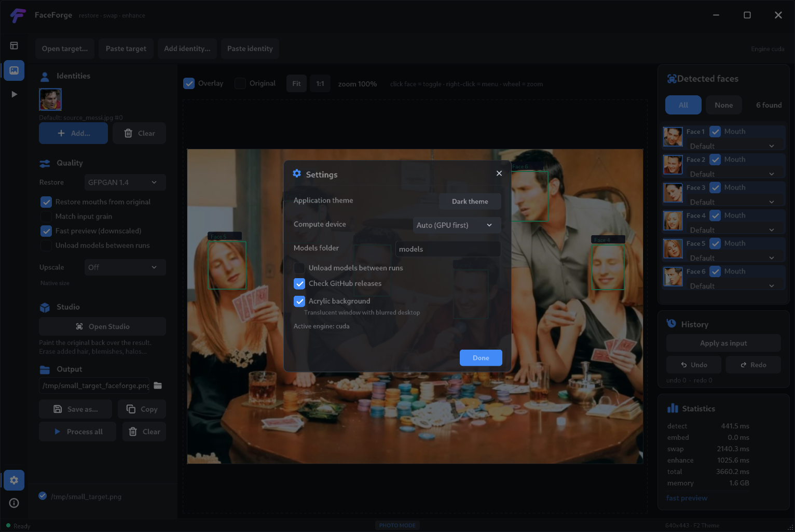
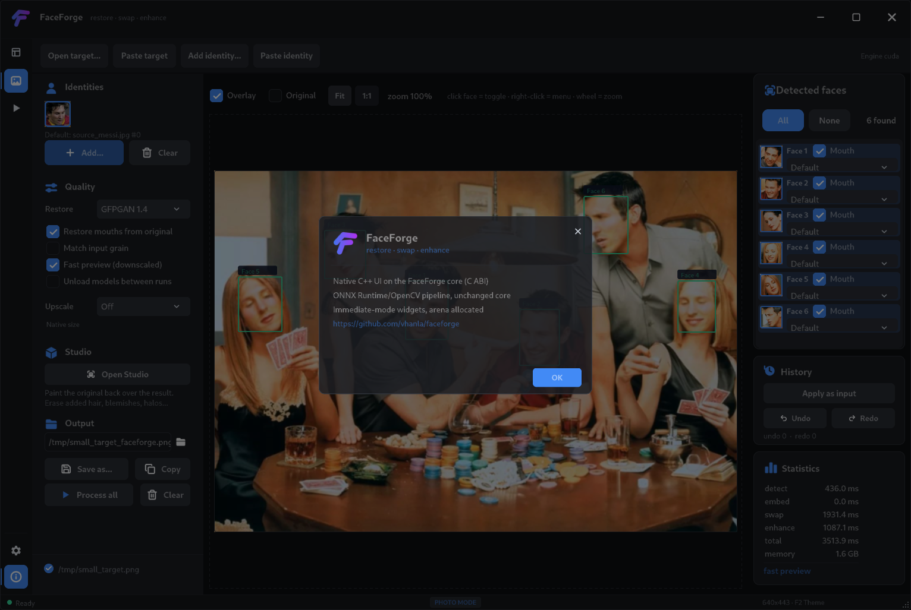
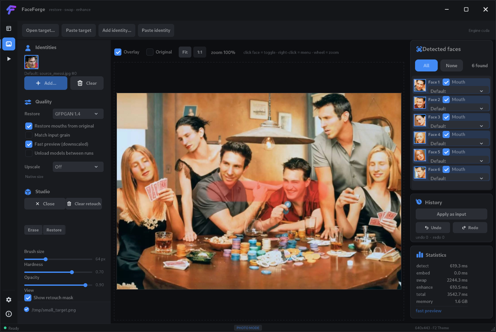
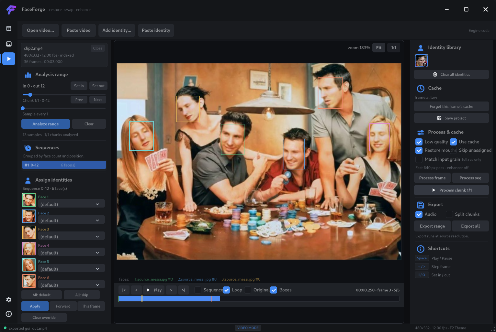

# FaceForge

Native face restoration and face swapping for **Linux and Windows**, built
around **ONNX Runtime** and **OpenCV** with a **native C++** desktop UI. No
webview, no Python at runtime, no cloud calls.

The application detects faces, extracts an identity embedding, swaps every
selected face with `inswapper_128`, and optionally restores the result with
GFPGAN 1.4 or Real-ESRGAN. The GUI lets you choose which faces to replace, pick
a different identity for each face, restore the mouth of only some faces, and
compare the original against the result with a toggleable face overlay.



```
                target image                         identity image
                     │                                     │
              SCRFD det_10g                         SCRFD det_10g
                     │                                     │
         5-point landmarks                    all faces + landmarks
                     │                                     │
            ArcFace 112×112 alignment              ArcFace 112×112 align
                     │                                     │
                     │                              w600k_r50 embedding
                     │                                     │
                     │                          emap projection + L2 norm
                     │                                     │
                     └────────────► inswapper_128 ◄────────┘
                                        │
                            128×128 swapped patch
                                        │
                    inverse affine warp + diff-mask blend
                                        │
                          GFPGAN restore -> grain match -> upscale (all optional)
                                        │
                                   final image
```

## Features

- **GPU first, CPU fallback.** CUDA execution provider with an optional GPU
  arena limit in the core API (exposed by `ffbench --gpu-mem-limit`); the CPU
  provider is selected automatically when CUDA is not available. Sessions can
  be unloaded between stages (the `sequential` option) to fit a 4 GB card.
- **Editor workflow.** Open or paste a target, add any number of identity
  images, drop files on the identity panel or the canvas, click a face (or its
  row) to include/exclude it, and use the canvas or identity context menus for
  the common actions. Undo/redo, *Apply as input*, clipboard export and PNG
  saving are built in.
- **Identity library.** Every identity image you add contributes all of its
  detected faces to a flat library. Click a thumbnail to make it the default
  identity, clear the library with `Clear`, or pick a specific identity for any
  target face from that face's dropdown — combinations are unlimited
  (e.g. one face from `lena.jpg`, the rest from `messi.jpg`).
- **Hot per-face updates.** Every swapped face is cached as a 128×128 patch and
  its affine matrix, tagged with the identity, mouth flag and working
  resolution that produced it, so toggling a face or reprocessing a single
  face only recomposes from cache — the whole image is never swapped again.
  The enhancer is the only stage that must rerun for the composed image.
- **Two-level cache.** Patches are kept for both the full-resolution and the
  downscaled preview working copies, and a result signature skips the compose
  and enhancer pass entirely when nothing that affects the output changed.
  Flipping *Fast preview* back and forth reuses the patches already computed
  at that resolution (0 ms of swapping) instead of re-running the model.
- **Fast preview.** Interactive edits run on a downscaled working copy
  (long side 640 px); switch it off for final full-resolution output.
- **Restore mouths from original.** The inner-mouth region of the aligned
  original face is feathered back over the swap, keeping real teeth and
  expression. Enabled by default, with a per-face `Mouth` override so only
  selected faces keep their original mouth.
- **Native canvas.** Wheel zoom, middle-drag pan, 1:1/Fit, toggleable face
  overlay with numbered tags and thumbnails in the face list.
- **Studio retouch layer.** A paint layer over the composed result that reveals
  the original pixels: erase added hair, blemishes, halos or background bleed
  without discarding the rest of the swap. Adjustable brush size, hardness and
  opacity; erase/restore brushes; red mask preview; a *View original* toggle;
  per-stroke undo/redo. The mask lives at base resolution, survives quality
  toggles and re-renders, and is applied to save, copy and *Apply as input*.
- **Video workspace.** A purpose-built clip editor rather than a general NLE:
  chunked, resumable face analysis, editable sequences with per-sequence identity
  assignment (each face row shows a tinted face crop from the clip and the
  selected identity's preview), a chosen default identity or default skip for
  unassigned faces, per-face skip (`leave unchanged`) and per-frame overrides,
  optional mouth restoration, cached low/high-quality processing, a timeline with
  in/out range, playback with seeking and frame stepping, and ffmpeg export at
  the source resolution (optionally split into parts and concatenated
  losslessly, with the original audio muxed back). Each frame also has a
  **Studio retouch** layer: paint vector strokes that reveal the original,
  bypass or delete them, and copy one frame's retouch to the same face in the
  other frames of the sequence (position/size matching, with overwrite or skip
  for frames that already carry an edit). Sequences list how many frames are
  edited. Frames are decoded on demand and nothing is extracted except the
  processed frames worth caching. The still-image editor is untouched; switch
  with `Photo`/`Video`.
- **Real measurements.** `ffbench` records cold start, min/median/mean/p95,
  VRAM baseline/peak/end and RSS for every stage.
- **Pure C ABI.** The core is a shared library with a small `extern "C"`
  surface (`core/include/faceforge.h`), so the GUI could be replaced without
  touching the inference code.

## Repository layout

```
faceforge/
├── core/
│   ├── include/faceforge.h     public C ABI
│   └── src/
│       ├── align.cpp           Umeyama fit, ArcFace templates, blobs
│       ├── engine.cpp          API, pipeline, NVML, image I/O
│       ├── models.cpp          SCRFD, ArcFace, inswapper, GFPGAN, ESRGAN
│       ├── ort_session.cpp     ORT sessions + CUDA provider options
│       ├── video.cpp           on-demand decode, ffmpeg encode/concat/mux
│       └── internal.hpp
├── gui-native/
│   ├── app/                    native app layer + faceforge screen
│   │   ├── app.cpp             photo pipeline, patches, undo, settings
│   │   ├── video.cpp           video workspace (timeline, analysis, export)
│   │   ├── config.cpp          persisted settings (JSON) and version helpers
│   │   ├── ff.cpp              C ABI wrappers
│   │   ├── main.cpp            window, frame loop, textures
│   │   └── ui_faceforge.cpp    immediate-mode screens
│   ├── amuie/                  vendored AMUIE library (widgets, GLFW, OpenGL)
│   └── amuie-tests/            headless widget tests
├── bench/bench_main.cpp        benchmark CLI (also writes CSV)
├── bench/results/              generated measurements and images
├── scripts/
│   ├── fetch_deps.sh/.ps1      ONNX Runtime SDK
│   ├── fetch_models.sh/.ps1    weights + emap.bin
│   ├── build.sh/.ps1           CMake core + native GUI
│   ├── run_bench.sh/.ps1       benchmark matrix
│   ├── bench_to_md.py          CSV → Markdown
│   ├── extract_emap.py         inswapper emap initializer
│   └── verify_parity.py        numerical check vs. InsightFace
├── packaging/                  .deb, AppImage and Inno Setup packaging
├── assets/                     small sample images (testing only)
├── docs/                       screenshots + design notes
├── CHANGELOG.md                release notes (Keep a Changelog)
├── models/                     weights (git-ignored)
├── third_party/                ONNX Runtime SDK (git-ignored)
├── .github/workflows/ci.yml    Linux + Windows builds
├── .github/workflows/release.yml  release packages (tag or manual)
├── vcpkg.json                  OpenCV manifest (Windows)
└── CMakeLists.txt              core; gui-native/CMakeLists.txt builds the UI
```

The earlier Zig + DVUI desktop UI is archived on the `legacy-zig` branch. `main`
ships only the native C++ UI.

## Requirements

Tested on Linux with:

| Component | Version |
|---|---|
| CMake | 4.4 |
| C++ compiler | GCC 15 (C++17 core, C++20 UI) |
| OpenCV | 5.0 (4.x also supported) |
| ONNX Runtime | 1.31.1, `gpu_cuda13` build |
| CUDA | 13.4 |
| cuDNN | 9.27 |
| GLFW | 3.3+ (3.4 is fetched when missing) |
| OpenGL | 3.3 core |
| FFmpeg | any recent build, `ffmpeg` on `PATH` (video export) |
| GPU | NVIDIA GTX 1650, 4 GB |

Windows is supported through MSVC (Visual Studio 2022 Build Tools, C++17) or
MinGW-w64, with OpenCV 4.x and the `onnxruntime-win-x64-*` packages. CUDA,
cuDNN and ONNX Runtime 1.31 are current for either OS.

CPU-only operation needs the `cpu` ONNX Runtime package and no CUDA. On Linux
set `ORT_FLAVOR=cpu scripts/fetch_deps.sh`; on Windows use
`.\scripts\fetch_deps.ps1 -Flavor cpu`.

### Platform notes

Both platforms share the same C++ core. The only OS-specific code is memory and
time introspection: `ff_memory_info` uses `GetProcessMemoryInfo`/PSAPI on
Windows and `/proc/self/statm` on Linux, while NVML is loaded dynamically from
`nvml.dll` or `libnvidia-ml.so.1`. Timestamps go through `ff_now_ns` in the
core, so the GUI has no platform-specific clock code.

Model and image paths are opened with `std::filesystem::u8path` and
`cv::imdecode`/`cv::imencode`, so folders and filenames with accents or other
non-ASCII characters work on Windows. `windows.h` is included with `NOMINMAX`
to keep `std::min`/`std::max` intact. On Windows the core build copies
`faceforge.dll`, the ONNX Runtime provider DLLs and the OpenCV runtime DLLs next
to the executables, and the GUI target copies them into `build-native`, so that
directory is self-contained.

## Quick start

### Linux

```bash
# 0. GUI dependencies (Debian/Ubuntu): GLFW + OpenGL/X11 headers
#    sudo apt-get install libglfw3-dev libgl1-mesa-dev libx11-dev

# 1. ONNX Runtime SDK (~245 MB)
scripts/fetch_deps.sh

# 2. models (~1.2 GB; not redistributed)
#    needs `unzip` and, for emap extraction, `python3 -m pip install onnx numpy`
scripts/fetch_models.sh

# 3. build everything
scripts/build.sh

# 4. run the GUI from the project root (paths are relative to it)
./build-native/faceforge-gui
```

### Windows (PowerShell)

```powershell
# 1. ONNX Runtime SDK
#    CPU only: .\scripts\fetch_deps.ps1 -Flavor cpu
.\scripts\fetch_deps.ps1

# 2. models (needs Python with `pip install onnx numpy`)
.\scripts\fetch_models.ps1

# 3. build everything
.\scripts\build.ps1

# 4. run the GUI from the project root (paths are relative to it)
.\build-native\faceforge-gui.exe
```

OpenCV is resolved in this order on Windows: `-OpenCVDir <path>` (folder with
`OpenCVConfig.cmake`), then vcpkg when `VCPKG_ROOT` / `VCPKG_INSTALLATION_ROOT`
is set (see `vcpkg.json`), then whatever CMake can find. `build.ps1` honors
the `OpenCV_DIR` environment variable. The ONNX Runtime DLLs are copied next to
the executables, so the build is runnable from `build-native\`.

Run the app from the repository root: the default target
(`assets/target_t1.jpg`), the default identity (`assets/source_lena.jpg`) and
the `models` folder are resolved relative to the working directory. When those
files are absent (a packaged install) the app starts with an empty canvas.
`FACEFORGE_TARGET`, `FACEFORGE_IDENTITY` (a `;`-separated list, or `--identity`
repeated) and `FACEFORGE_PROVIDER=cpu|cuda` override the defaults, and
`FACEFORGE_SEQUENTIAL=1` is the same as ticking *Unload models between runs*.

Headless rendering is available through `--screenshot OUT`: the app draws a
few frames, writes a PPM and exits. `--frames N`, `--wait` (screenshot once the
pipeline goes idle) and `--size WxH` shape that capture, and
`FACEFORGE_STUDIO=1` / `FACEFORGE_STUDIO_PAINT=1` open Studio with a sample
retouch stroke. There is no scripted photo-mode end-to-end run in the native UI
yet; the video workspace has `FACEFORGE_VIDEOTEST` (see below).

### Build options

```bash
scripts/build.sh --core      # C++ core + ffbench only
scripts/build.sh --gui       # native GUI only (core must exist)
JOBS=8 scripts/build.sh      # parallel build
```

```powershell
.\scripts\build.ps1 -CoreOnly
.\scripts\build.ps1 -GuiOnly
.\scripts\build.ps1 -OpenCVDir C:\opencv\build -Jobs 8
```

The repository has two CMake projects: the root one builds the C++ core and the
benchmarks, and `gui-native/` builds the UI against the core's artifacts. The
scripts run both in order; to do it by hand:

```bash
cmake -S . -B build -DCMAKE_BUILD_TYPE=Release && cmake --build build -j
cmake -S gui-native -B build-native -DCMAKE_BUILD_TYPE=Release
cmake --build build-native -j
```

Release packages stay generic on purpose. Hot loops detect AVX2/FMA at runtime
and fall back to scalar code otherwise. For a local build tuned to your own
CPU, configure CMake with `-DFF_NATIVE_BUILD=ON` (`-march=native` on
GCC/Clang, `/arch:AVX2` on MSVC). See
[`docs/optimization.md`](docs/optimization.md) for the measurements and the
newer-hardware TODO.

## Using the GUI

The window has a collapsible icon rail on the left (Photo, Video, Settings,
About), a toolbar with the open/paste actions, the identity, quality, Studio and
output panel, the canvas, and the detected-face list, history and statistics on
the right.

1. **Load images.** Use `Open target...` / `Add identity...` (multi-select),
   paste from the clipboard (`Paste target` / `Paste identity`), or drop a file
   on the identity panel (identity) or the canvas (target). `Add identity...`,
   drops and pastes append to the identity library; existing identities are
   kept. Right-click the identity panel for *Add identity...*, *Paste identity*
   and *Clear all*; right-click the canvas for *Paste target*, *Open target...*,
   *Reset View / Fit*, *1:1 Pixel View* and *Clear Canvas*.
2. **Identity library.** Each added image contributes one thumbnail per face it
   contains, labelled `<file> #<n>`. Click a thumbnail to make it the default
   for every face without an explicit choice; the label under the row names the
   current default. Thumbnails have no context menu; use `Clear` to empty the
   library.
3. **Quality.** Choose the face restoration (`None`, `GFPGAN 1.4`) and an
   optional frame *Upscale* (`Off`, `2x`, `4x`, or the `1080p`/`1440p`/`4K`
   presets offered for 16:9 inputs). *Match input grain* re-applies the original
   noise on restored faces so they do not look pasted (see
   `docs/grain_matching.md`). Keep *Restore mouths from original* on unless you
   want the swap's own mouth, and leave *Fast preview* on while composing. Turn
   it off for the final render — patches for both resolutions are cached, so
   toggling only computes what is missing. *Unload models between runs* frees
   sessions after every job.
4. **Faces.** Detection runs automatically after loading. `All` / `None` toggle
   every face. Each row has a thumbnail, a `Mouth` checkbox and a `Face`
   dropdown listing `Default`, the identity library and `Skip face` (which keeps
   the original pixels). Clicking a row toggles the swap; changing the dropdown
   reprocesses only that face. Skipped faces are drawn with a grey box.
5. **Canvas.** Wheel zooms around the cursor, middle-drag pans, `Fit` and `1:1`
   reset the view. The `Overlay` checkbox hides the boxes and numbered tags, and
   `Original` switches between the composed result and the untouched input
   (Studio has its own *View original*).
6. **History.** *Apply as input* installs the composed result as the new base
   image (useful for stacking passes) and pushes the previous base onto the
   undo stack; `Undo`/`Redo` restore those snapshots. These buttons are the only
   workspace history entry points outside Studio.
7. **Studio.** *Open Studio* turns the canvas into a retouch editor: paint with
   the left button to reveal the original under the result, or switch to
   *Restore* to paint the swap back; right-click toggles the mode on the fly.
   *Brush size*, *Hardness* and *Opacity* shape the brush (size is in
   base-image pixels), and *Show retouch mask* tints the painted area red.
   *View original* previews the untouched base. Strokes are undone/redone
   individually with `Undo`/`Redo` in the retouch panel, and *Clear retouch*
   starts over. The mask is stored at the base resolution, so it is preserved
   when toggling *Fast preview*, changing the enhancer or reprocessing faces,
   and it is blended into everything you save, copy or apply as input. *Close*
   leaves Studio but keeps the retouch applied.
8. **Export.** `Copy` writes a PNG of the result to the clipboard; `Save as...`
   opens a save dialog seeded with the path in the output field. The field
   defaults to `<export folder>/<target stem>_faceforge.png`, where the export
   folder comes from the settings file or `--export-dir` (the target's own
   folder when it is empty). `Process all` reprocesses every face and `Clear`
   unloads the target.
9. **Settings and About.** Both open as modal dialogs from the left rail.
   `Settings` holds only rarely-changed options: application theme, compute
   device (`Auto`, `CUDA`, `CPU`), models folder, *Unload models between runs*,
   *Check GitHub releases* and *Acrylic background* (applied on the next
   launch). It also shows the active engine and saves the config when you press
   *Done*. The enhancer, mouth restoration, fast preview and canvas overlay
   stay in the workspace panel where they are used. `About` shows the tagline,
   the native UI/core notes and the repository URL. `Esc` closes either dialog
   (and quits when no dialog is open).

Shortcuts: `F2` toggles the light/dark theme, `Ctrl+C` copies the result in
Photo mode, `Ctrl+V` pastes an image, and the video workspace adds `Space`,
the arrow keys, `Home`/`End` and `I`/`O` (see the video section). Text fields
support the usual `Ctrl+A`/`C`/`V`/`X`.






Timings for the last job are shown in the right rail, together with the process
memory and the resolution/mode used (`fast preview` or `full resolution`). The
active engine is shown in Settings and in the toolbar. With *Fast preview* on,
the canvas shows the downscaled composite. Per-face hot updates recompose from
cached 128×128 patches, so a toggle is typically tens of milliseconds plus
however long the selected enhancer takes on the whole image. Edits made while a
job is still running are never lost: they are coalesced into a single follow-up
pass when it finishes, and that pass only re-swaps the faces that actually went
stale.

The startup identity list can also come from `FACEFORGE_IDENTITY`, which
accepts a semicolon-separated list (e.g.
`assets/source_lena.jpg;assets/source_messi.jpg`).

## Settings, folders and updates

The Settings dialog intentionally contains only options that are changed once:
the theme, the execution provider, the models folder, unloading sessions
between runs, the release-check preference and the acrylic background. The
temporary and export folders are not exposed there; they are read from the
settings file and the CLI. The frequently used quality controls stay in the
editor and video panels. About shows the app tagline, the native UI/core notes
and a link to `https://github.com/vhanla/faceforge`.

### Folder defaults

| Folder | Default | Used for |
|---|---|---|
| Models | `models` (relative to the working directory) | `det_10g.onnx`, `w600k_r50.onnx`, `inswapper_128.onnx`, the enhancers and `emap.bin` |
| Temp | empty | video analysis/processed-frame caches and the audio-mux intermediate. Empty means `<video folder>/.faceforge.cache` |
| Exports | empty | default save/export folder. Empty means next to the input |

Models is editable in Settings. Set Temp and Exports in the settings file or
with `--temp-dir` / `--export-dir`. With a configured Temp folder every clip
gets its own `<temp>/<stem>-<hash>.faceforge.cache`, so caches from different
clips never collide and can be deleted independently. Photo results are named
`<stem>_faceforge.png`; exported videos are `<stem>_faceforge.mp4`. An explicit
`Save as...` path or `--save` overrides the photo default.

### Configuration file

Settings are saved as JSON:

- Linux: `$XDG_CONFIG_HOME/faceforge/settings.json`, or
  `~/.config/faceforge/settings.json`
- Windows: `%APPDATA%\faceforge\settings.json`

```json
{
  "version": 1,
  "provider": "cuda",
  "models_dir": "models",
  "temp_dir": "/mnt/work/faceforge-cache",
  "export_dir": "/home/me/Pictures/faceforge",
  "unload_after_run": false,
  "check_updates": true,
  "acrylic": true,
  "update_interval_hours": 24,
  "last_update_check": 1793819640
}
```

Pass `--config FILE` (or set `FACEFORGE_CONFIG`) to use a different file;
`--no-config` disables loading and saving. Missing fields fall back to the
defaults, so older files keep working. The file is written when you press
*Done* in Settings and on exit after a change. The path is not shown in the UI.
The light/dark theme and acrylic are decided at startup: the theme is per
session (`--light` or `F2`), and an acrylic change takes effect on the next
launch.

### CLI and environment

Command line overrides win over environment variables, which win over the
config file, which wins over the defaults.

| CLI | Environment | Meaning |
|---|---|---|
| `--provider auto\|cuda\|cpu` | `FACEFORGE_PROVIDER` | execution provider |
| `--models DIR` | `FACEFORGE_MODELS` | model folder |
| `--temp-dir DIR` | `FACEFORGE_TEMP_DIR` | cache/work folder |
| `--export-dir DIR` | `FACEFORGE_EXPORT_DIR` | default output folder |
| `--config FILE` | `FACEFORGE_CONFIG` | settings file |
| `--no-config` | — | do not read or write settings |
| `--target FILE` | `FACEFORGE_TARGET` | startup target image |
| `--identity FILE` | `FACEFORGE_IDENTITY` | identity image; repeatable or `;`-separated |
| `--save FILE` | — | path shown in the output field |
| `--video [FILE]` | `FACEFORGE_VIDEO` | open the video workspace |
| `--light` | — | start with the light theme |
| `--acrylic` / `--no-acrylic` | `FACEFORGE_ACRYLIC` | translucent window over a blurred desktop |
| `--no-update-check` / `--check-updates` | `FACEFORGE_CHECK_UPDATES` | persisted release-check preference |
| — | `FACEFORGE_UPDATE_INTERVAL_HOURS` | persisted check interval |
| — | `FACEFORGE_SEQUENTIAL=1` | unload sessions between runs |
| `--screenshot OUT` | — | render, write a PPM and exit |
| `--frames N` | — | frames to render before the screenshot |
| `--wait` | — | screenshot once the pipeline goes idle |
| `--size WxH` | — | initial window size |
| `--help` | — | usage |
| — | `FACEFORGE_SETTINGS=1` / `FACEFORGE_ABOUT=1` | open Settings/About at startup |
| — | `FACEFORGE_STUDIO=1` / `FACEFORGE_STUDIO_PAINT=1` | open Studio (and paint a sample stroke) |
| — | `FACEFORGE_VIDEOTEST=path` / `FACEFORGE_VIDEOTEST_KEEP=1` | scripted video check |
| — | `FACEFORGE_SELFTEST=1` | full-resolution mode; ignore the config file |

`FACEFORGE_VIDEOTEST` opens a clip, analyses and processes the first frames,
exports a short range and plays it back, then exits; `FACEFORGE_VIDEOTEST_KEEP=1`
leaves the window open on the result instead. `FACEFORGE_SELFTEST` and
`FACEFORGE_VIDEOTEST` ignore the user's config file unless `--config` or
`FACEFORGE_CONFIG` was supplied explicitly, keeping CI runs hermetic. There is
no scripted photo-mode end-to-end driver yet.

### Update checks

The *Check GitHub releases* checkbox, `--check-updates` / `--no-update-check`
and `FACEFORGE_CHECK_UPDATES` only persist a preference: the native UI does not
perform a network check yet, and About shows no update status. Nothing is
queried or downloaded, and `update_interval_hours` / `last_update_check` are
reserved for a future implementation.

### CI and releases

`.github/workflows/ci.yml` builds the core and GUI on Linux and Windows for
every push and assembles the packages without publishing, so packaging
breakage fails early. `.github/workflows/release.yml` builds the distributable
packages and can publish them:

| Artifact | Notes |
|---|---|
| `faceforge-<version>-linux-x64.tar.gz` | Portable bundle; needs the host OpenCV/FFmpeg/GStreamer runtime. |
| `faceforge_<version>_amd64.deb` | Debian/Ubuntu package. Runtime libraries are declared with `dpkg-shlibdeps` and ONNX Runtime is bundled. |
| `faceforge-<version>-x86_64.AppImage` | Portable Linux image that bundles the linked libraries; video decoding still needs the host GStreamer plugins. |
| `faceforge-<version>-windows-x64.zip` | Portable x64 bundle. |
| `faceforge-<version>-windows-x64-setup.exe` | Inno Setup installer (x64 only). |

The installer is per-user by default: it installs under
`%LOCALAPPDATA%\Programs\FaceForge` without elevation. Choosing an all-users
install in the wizard asks for UAC and uses `%ProgramFiles%`. Models and the
fetch helper always live under `%LOCALAPPDATA%\FaceForge` (or
`~/.local/share/faceforge` on Linux), so nothing writes into a read-only
install directory.

Push a tag like `v0.2.0` to publish, or run the workflow manually with a
version and *publish* enabled to release on demand. An existing release for the
same tag is never overwritten unless *overwrite* is enabled. The version names
the release and the package files. Release notes come from the matching section
of `CHANGELOG.md` (`scripts/changelog.py notes <version>`) and fall back to
`git log` when there
is no entry. Model weights are never included — the packages ship
`fetch_models.sh` / `fetch_models.ps1`.

## Editing video

The `Video` entry in the left icon rail switches to a workspace built specifically
for face swapping in clips. It shares the identity library and the engine with
the still-image editor but owns its project file, timeline, caches and jobs, so
switching back to `Photo` leaves that work untouched.



1. **Open a clip.** `Open video...` or drop a video anywhere in the window. The
   container stays open and frames are decoded on demand — nothing is written to
   disk until a processed frame is cached. Metadata (resolution, fps, frame
   count, duration) is read straight from the container.
2. **Pick a range.** `Set in` / `Set out` (or the `I`/`O` keys) bound the part of
   the clip worth analysing — skip intros and credits. `Chunk` sets how many
   frames are analysed per step and `Sample every` sets the detection stride.
   The range is drawn on the timeline with the analysed chunks underneath.
3. **Analyse.** `Analyze range` runs detection in a background worker, one chunk
   at a time. Every finished chunk is folded into the project and saved
   immediately, so `Cancel` (or closing the app) never loses completed work and
   the analysis can be resumed later. Re-analysing a range replaces only the
   samples inside it.
4. **Sequences.** Detections are grouped into a small number of contiguous
   sequences by face count and position — crowded shots collapse into fewer,
   longer sequences instead of a per-frame list. Pick a sequence (its frame
   range is highlighted) and assign an identity to each face with the dropdowns,
   or pick `(leave unchanged)` to keep that face exactly as it is in the source
   while the other faces in the same frame are still swapped; skipped faces get
   a neutral grey box and `unchanged` in the legend. Each `Face N` row carries a
   thumbnail cropped from the sequence's start frame and tinted with the same
   colour as its viewer outline, so rows can be matched to faces visually
   instead of by number alone; the dropdown shows a preview of the identity it
   will apply. `All: default` / `All: skip` set every row at once, and
   `Skip unassigned` makes newly seen faces stay untouched unless you assign
   them. `Apply` sets the whole sequence, `Forward` propagates it to everything
   after it, `This frame` stores a one-frame exception and `Clear override`
   removes it. Assignments are stored as frame ranges, so they survive
   re-analysis.
5. **Process & cache.** `Process frame`, `Process seq` or `Process chunk N/M`
   render the swap with the current assignments. `Restore mouths` applies
   the photo editor's mouth restoration to the swapped faces. `Match input grain`
   re-applies the clip's original texture on the restored faces; it is a
   separate video setting (the photo checkbox does not affect it), applies to
   high quality only, and toggling it invalidates cached frames. Blurring is
   limited to the padded face regions and the pass runs in place, so it adds
   roughly 16 ms at 1080p and 56 ms at 4K per frame instead of 31/122 ms.
   `Low quality` works on a 640 px-long-side clone and **never runs the
   enhancer** (fast previews); leave it off to swap at the source resolution
   with the chosen enhancer. A line under the checkboxes states what will
   happen for the current clip (for example `Fast 640 px pass · enhancer off`,
   `Full res · enhancer on` or `Full res · enhancer failed for this clip`).
   GFPGAN works on each
   face's 512×512 crop, so memory does not grow with frame size and high quality
   attempts the enhancer even on large frames and small GPUs. If a crop really
   fails, the remaining faces are still enhanced (a per-face split fallback) and
   only a hard failure disables the enhancer for the rest of the clip — the
   swapped frame is kept instead of aborting the job. Results are cached per
   content signature under the Temp folder as
   `<temp>/<stem>-<hash>.faceforge.cache/<signature>/<low|high>/f########.jpg`
   (or `<video folder>/.faceforge.cache/...` when Temp is empty), so
   changing an assignment naturally invalidates stale frames instead of showing
   them, and processed frames are reused by the player and by export. The viewer
   prefers the high-quality entry when both exist. The Low/High choice is kept
   when opening another video.
6. **Retouch a frame (Studio).** Turn on `Paint retouch on this frame` and drag
   over the viewer to reveal the original under the swap; `Erase`/`Restore` (or
   right-click) pick the brush, and the `Size`, `Hard` and `Opacity` sliders
   shape it. Strokes are stored as vectors in source-frame pixels, so they stay
   sharp at any resolution and survive reprocessing. `View original` shows the
   untouched frame, `Bypass this edit` temporarily disables the retouch (the
   sequence line still counts it), and `Undo stroke` / `Delete edit` / `Clear`
   remove work. `Copy to similar` finds the same face in the other frames
   of the sequence by size and position, offsets the strokes to each face box
   and copies them; if some targets are already edited you choose `Overwrite` or
   `Skip edited`. Edits are saved in the project and stamped into exported
   frames (active, non-bypassed edits only).
7. **Review.** The centre viewer shows the original until a frame has a cached
   result, then shows the result; in Studio the canvas shows the processed frame
   even when it is not cached yet. `Original` forces the untouched frame back and
   `Boxes` hides the per-face outlines. Transport buttons, clicking or
   dragging on the timeline, `Space`, `Left`/`Right` (`Shift` for 10 frames) and
   `Home`/`End` seek. `Loop` repeats the playback range, and `Sequence` narrows
   playback to the selected sequence so a partly processed swap can be reviewed
   over and over without waiting for the whole clip. Playback runs on its own
   clock — the frame keeps repainting between steps instead of only reacting to
   input.
8. **Export.** `Export range` or `Export all` encode with ffmpeg at the source
   resolution, reusing high-quality cache entries and stamping active retouches.
   `Audio` muxes the original clip's track for the exported span, and
   `Split chunks` encodes the range in parts and concatenates them without
   re-encoding (good for long clips). The project is saved next to the video as
   `<stem>.faceforge.json`, and the default output is
   `<export folder or video folder>/<stem>_faceforge.mp4`.

`FACEFORGE_VIDEO=<path>` opens a clip directly in the video workspace at
startup, and `FACEFORGE_VIDEOTEST=<path>` runs a headless end-to-end check
(analyse, process, export) and exits — `FACEFORGE_VIDEOTEST_KEEP=1` leaves the
window open on the result instead.

## Benchmarking

```bash
scripts/run_bench.sh                     # CUDA + CPU matrix
REPEATS=10 scripts/run_bench.sh          # more repetitions
PROVIDERS=cuda scripts/run_bench.sh      # GPU only
```

```powershell
.\scripts\run_bench.ps1
.\scripts\run_bench.ps1 -Repeats 10
.\scripts\run_bench.ps1 -Providers cuda
```

The script writes `bench/results/bench.csv` and a Markdown summary to
`bench/results/latest.md`. Raw `ffbench` invocation:

```bash
build/ffbench --provider cuda --stage full --enhancer gfpgan --repeats 5
build/ffbench --provider cuda --stage swap --repeats 10
build/ffbench --provider cpu  --stage detect --repeats 10
```

Stages: `detect`, `embed`, `swap`, `enhance`, `full`, `all`. Providers:
`cuda`, `cpu`, `auto`. Enhancers: `none`, `gfpgan`, `esrgan2`, `esrgan4`.
Every stage is measured after unloading the sessions, so `cold` includes
session creation and the warm numbers are pure inference.

See [`bench/results/latest.md`](bench/results/latest.md) for the raw table and
[`bench/results/REPORT.md`](bench/results/REPORT.md) for the full analysis on
the reference machine.

## Memory behaviour (4 GB target)

Measured session deltas on a GTX 1650 (desktop already using ~1.4 GB during the run):

| Session | Peak VRAM delta |
|---|---:|
| SCRFD `det_10g` | ~110 MB |
| ArcFace `w600k_r50` | ~380 MB |
| `inswapper_128` | ~760 MB |
| GFPGAN 1.4 | ~1.39 GB |
| Real-ESRGAN x2 | ~475 MB |
| Real-ESRGAN x4 | ~1.73 GB |

On the reference machine a resident full pipeline with GFPGAN peaked at
**4041 MiB used**, with ~1415 MiB already taken by the desktop. Enabling
`sequential` (or the GUI's *Unload models between runs*) releases sessions
between stages and lowers the peak to **3516 MiB**, at the cost of reloading
them (the warm run grows from ~2.2 s to ~4.5 s). Real-ESRGAN x4 uses more VRAM
than GFPGAN and is much slower, so GFPGAN is the better fit for 4 GB.

The CUDA provider is configured with:

- no explicit `gpu_mem_limit` by default, so ONNX Runtime grows the arena as
  needed (`--gpu-mem-limit MiB` sets a hard cap),
- `arena_extend_strategy = kSameAsRequested`, which avoids the default
  power-of-two over-allocation on a 4 GB card,
- `cudnn_conv_algo_search = HEURISTIC` for fast, predictable session startup.

## Alignment and paste-back

Detection uses SCRFD with a 640×640 letterboxed input. Each face is aligned to
the standard ArcFace 5-point template (112×112 for recognition, 128×128 with
`diff_x = 8` for `inswapper`). The swap is fed the normalized embedding after
the `emap` projection (`normalize(embedding @ emap)`), matching InsightFace.

The swapped patch is pasted back with the same procedure used by InsightFace:
invert the alignment affine, warp the 128×128 patch into the original image,
build a mask from the absolute difference between the warped patch and the
original region, threshold at 10, erode/dilate and Gaussian-blur it, then
alpha-blend. This keeps hair, glasses and jaw edges from looking cut out.

`scripts/extract_emap.py` reads the 512×512 `emap` initializer from the ONNX
graph once, because ONNX Runtime's C/C++ API does not expose graph
initializers. The resulting `models/emap.bin` is a raw little-endian float32
matrix.

## Numerical parity

`scripts/verify_parity.py` compares the native core against the InsightFace
Python reference on CPU:

```bash
python3 scripts/verify_parity.py --models models --core build/libfaceforge.so
```

Last run: 6/6 detections, 0.0000 px bbox/landmark error, embedding cosine
0.9999277, swap mean absolute difference 0.0113 (p99 = 1, max = 3 out of 255).
The parity images are in `bench/results/parity_*.png`.

## Models and licenses

| File | Source | License |
|---|---|---|
| `det_10g.onnx` | InsightFace buffalo_l | non-commercial research |
| `w600k_r50.onnx` | InsightFace buffalo_l | non-commercial research |
| `inswapper_128.onnx` | InsightFace / FaceFusion mirror | non-commercial, no redistribution |
| `gfpgan_1.4.onnx` | GFPGAN | Apache-2.0 |
| `real_esrgan_x2.onnx` | Real-ESRGAN | BSD-3-Clause |
| `real_esrgan_x4.onnx` | Real-ESRGAN | BSD-3-Clause |

The weights are **never committed**; `models/` and `third_party/` are
git-ignored and populated by the fetch scripts. If you ship a product, verify
the InsightFace terms yourself or replace the detection/recognition/swap
models with commercially licensed ones. CodeFormer is not used here.

## Troubleshooting

- **`engine creation failed: ... CUDA ...`** — check `nvidia-smi`, the CUDA
  and cuDNN versions, and that `third_party/onnxruntime/lib` is on
  `LD_LIBRARY_PATH` (Linux) or `PATH` (Windows) or reachable through the
  binary's rpath. The app falls back to CPU if `Auto` is selected.
- **Out of memory on 4 GB** — the resident pipeline needs ~2.6 GB on top of
  whatever the desktop uses (see the report). Enable *Unload models between
  runs* or `FACEFORGE_SEQUENTIAL=1`, switch the enhancer to `None`, close other
  GPU apps, or run `ffbench` with the CPU provider to confirm the models are
  fine. A CUDA allocation failure is surfaced as a pipeline error; the app
  itself keeps running.
- **`No face found`** — SCRFD needs a reasonably large face. Lower
  `--det-size` only makes it slower; instead crop the image or use a better
  photo.
- **The GUI opens but images are black** — run it from the project root so the
  default `assets/...` paths resolve, or type absolute paths.

## Status

This is a working reference implementation, not a polished product. The C ABI,
the pipeline and the GUI are functional and benchmarked. Linux and Windows are
both supported and built in CI, and the release workflow produces portable
archives; installers and macOS support remain out of scope for now.
